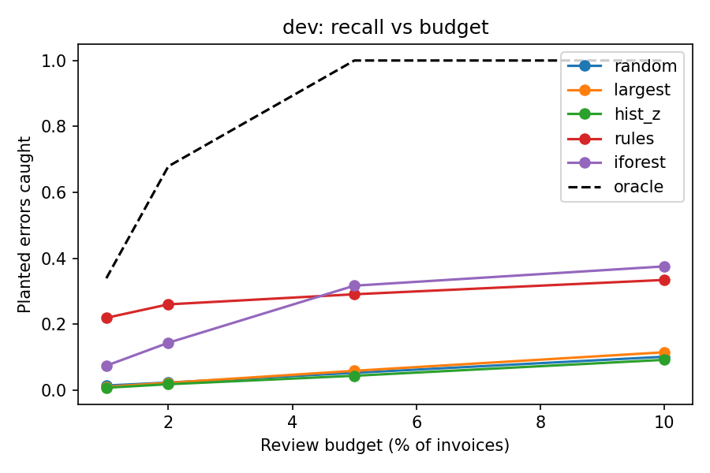

# Invoice Review Prioritizer

> Evaluated on a synthetic error-injection benchmark using real retail transactions. Results include a held-out TEST period and a held-out `wrong_product` error type; they do not measure realized fraud or billing-error detection.

Retail transaction-review prototype for evaluating anomaly prioritization under fixed analyst review budgets (`1%`, `2%`, `5%`, and `10%` of invoice volume).

* **Dataset:** UCI Online Retail II (two years of UK retail sales transactions; `1,067,371` raw rows filtered to `1,031,104` valid rows across `39,434` invoices).
* **Evaluation scope:** Public retail transaction data does not include ground-truth fraud or billing-error labels. Benchmarks below measure performance on **synthetic error-injection stress tests** across 20 random seeds (`3%` invoice error rate), not realized fraud prevention or financial savings.

---

## Architecture & Leakage Controls

1. **Whole-invoice chronological splits (`split_periods`):** Splits the timeline by invoice-date quantiles (`35% H` / `15% F` / `20% DEV` / `30% TEST`) while keeping entire invoices together (`13,802` / `5,915` / `7,887` / `11,830` invoices). Invoices spanning conflicting timestamps or multiple customer IDs (`82` IDs, `5,772` rows) are excluded rather than inventing an availability order.
2. **Frozen point-in-time baselines (`History`):** Computes log-space medians and Median Absolute Deviations (`MAD * 1.4826`) strictly from earlier periods (`H + F` for `DEV`; `H + F + DEV` for `TEST`). Product and customer baselines require at least `MIN_HIST = 5` historical observations; cold-start lines default to `0.0` deviation with explicit missing-history indicators (`nohist`, `noqtyhist`).
3. **Strictly prior multiset duplicate matching (`duplicate_scores`):** Computes 30-day rolling multiset Jaccard similarity across `(stockcode, quantity, price)` line counts against strictly earlier timestamps (`d[j] < d[i]`) for the same customer (or matching invoice total when `customer` is missing).
4. **Ranking methods (`METHODS`):**
   * `rules`: Transparent heuristic combining size-weighted duplicate similarity (`dup_sim >= 0.8` weighted by `10 / 6 / 3` for `>=3 / 2 / 1` lines) plus capped maximum line price/quantity z-score (`cap = 10.0`).
   * `iforest`: Unsupervised `IsolationForest` (`n_estimators = 200`) fit on the uninjected `F` period using `["max_price_dev", "max_qty_dev", "log_lines", "log_total", "dup_sim", "nohist"]`.
   * Baselines: `random`, `largest` (invoice GBP total), and `hist_z` (customer/global invoice-total log-MAD z-score).

---

## Development Results (`DEV` Period, 20 Seeds)

Evaluated across `7,887` DEV invoices (`~235` planted errors per seed). One frozen ranking per method and seed is reused across all budget cutoffs.



### Recall by Review Budget (Share of Planted Errors in Top $k$ Invoices)
| method | 1% budget | 2% budget | 5% budget | 10% budget |
|---|---|---|---|---|
| random | 0.014 | 0.023 | 0.053 | 0.101 |
| largest | 0.010 | 0.022 | 0.059 | 0.115 |
| hist_z | 0.007 | 0.018 | 0.044 | 0.092 |
| rules | 0.219 | 0.260 | 0.291 | 0.334 |
| iforest | 0.074 | 0.144 | 0.317 | 0.376 |
| oracle | 0.339 | 0.679 | 1.000 | 1.000 |

### Detailed Metrics at a 5% Review Budget (`k = 399` Invoices)
*Note: `unchanged_flags` counts reviewed invoices without a planted error; because uninjected retail data is not verified clean, these are not labeled "false positives." `value_recall` measures the share of planted invoices' recorded GBP value captured.*

| method | recall | sd | unchanged_flags | unchanged_flag_rate | unchanged_eligible | value_recall | oracle |
|---|---|---|---|---|---|---|---|
| random | 0.053 | 0.013 | 386.600 | 0.050 | 7729.000 | 0.051 | 1.000 |
| largest | 0.059 | 0.014 | 385.150 | 0.050 | 7729.000 | 0.366 | 1.000 |
| hist_z | 0.044 | 0.014 | 388.700 | 0.050 | 7729.000 | 0.118 | 1.000 |
| rules | 0.291 | 0.017 | 330.450 | 0.043 | 7729.000 | 0.324 | 1.000 |
| iforest | 0.317 | 0.017 | 324.300 | 0.042 | 7729.000 | 0.390 | 1.000 |

### Recall at 5% Budget by Error Type & Severity
| type | severity | random | largest | hist_z | rules | iforest |
|---|---|---|---|---|---|---|
| dup_invoice | exact | 0.059 | 0.052 | 0.051 | 0.894 | 1.000 |
| dup_invoice | near | 0.037 | 0.037 | 0.059 | 0.602 | 0.754 |
| price_x | 1.15 | 0.041 | 0.061 | 0.046 | 0.039 | 0.039 |
| price_x | 1.5 | 0.063 | 0.038 | 0.042 | 0.031 | 0.048 |
| price_x | 2.0 | 0.052 | 0.069 | 0.033 | 0.177 | 0.027 |
| qty_x | 10 | 0.062 | 0.102 | 0.050 | 0.052 | 0.071 |
| qty_x | 2 | 0.069 | 0.063 | 0.037 | 0.043 | 0.028 |
| qty_x | 5 | 0.042 | 0.062 | 0.021 | 0.050 | 0.031 |

---

## Held-Out Results (`TEST` Period, 20 Seeds)

The TEST period contains `11,830` invoices. It was held out from development, and TEST-only injections include the `wrong_product` error type. Each seed plants about `352` errors (`3%` of invoices). These remain synthetic stress-test results, not fraud-prevention performance.

### Recall by Review Budget (Share of Planted Errors in Top $k$ Invoices)
| method | 1% budget | 2% budget | 5% budget | 10% budget |
|---|---|---|---|---|
| random | 0.009 | 0.021 | 0.052 | 0.108 |
| largest | 0.011 | 0.023 | 0.059 | 0.118 |
| hist_z | 0.009 | 0.016 | 0.045 | 0.097 |
| rules | 0.191 | 0.201 | 0.233 | 0.287 |
| iforest | 0.116 | 0.170 | 0.253 | 0.322 |
| oracle | 0.340 | 0.677 | 1.000 | 1.000 |

### Detailed Metrics at a 5% Review Budget (`k = 592` Invoices)
*Note: `unchanged_flags` counts reviewed invoices without a planted error; these are not confirmed clean. `value_recall` measures the share of planted invoices' recorded GBP value captured, not loss or savings.*

| method | recall | sd | unchanged_flags | unchanged_flag_rate | unchanged_eligible | value_recall | oracle |
|---|---|---|---|---|---|---|---|
| random | 0.052 | 0.012 | 577.600 | 0.050 | 11564.050 | 0.047 | 1.000 |
| largest | 0.059 | 0.012 | 575.050 | 0.050 | 11564.050 | 0.406 | 1.000 |
| hist_z | 0.045 | 0.008 | 580.200 | 0.050 | 11564.050 | 0.099 | 1.000 |
| rules | 0.233 | 0.013 | 513.750 | 0.044 | 11564.050 | 0.219 | 1.000 |
| iforest | 0.253 | 0.015 | 506.600 | 0.044 | 11564.050 | 0.366 | 1.000 |

### Recall at 5% Budget by Error Type & Severity
| type | severity | random | largest | hist_z | rules | iforest |
|---|---|---|---|---|---|---|
| dup_invoice | exact | 0.064 | 0.043 | 0.053 | 0.905 | 1.000 |
| dup_invoice | near | 0.052 | 0.045 | 0.051 | 0.603 | 0.727 |
| price_x | 1.15 | 0.048 | 0.048 | 0.047 | 0.047 | 0.035 |
| price_x | 1.5 | 0.050 | 0.060 | 0.025 | 0.045 | 0.038 |
| price_x | 2.0 | 0.038 | 0.060 | 0.031 | 0.098 | 0.043 |
| qty_x | 10 | 0.066 | 0.116 | 0.052 | 0.034 | 0.064 |
| qty_x | 2 | 0.053 | 0.058 | 0.032 | 0.035 | 0.038 |
| qty_x | 5 | 0.053 | 0.072 | 0.028 | 0.052 | 0.032 |
| wrong_product | far | 0.055 | 0.050 | 0.060 | 0.128 | 0.166 |
| wrong_product | mid | 0.038 | 0.064 | 0.053 | 0.084 | 0.038 |
| wrong_product | near | 0.050 | 0.052 | 0.053 | 0.042 | 0.030 |

### Planted Errors on Invoices With No Price History for Any Line
| type | share_with_no_price_history |
|---|---|
| dup_invoice | 0.024 |
| price_x | 0.027 |
| qty_x | 0.017 |
| wrong_product | 0.006 |

## Real-Data Diagnostic Results

`diagnose.py` was run on the real UCI DEV period (`7,887` invoices), with 20 seeded plantings at a `3%` rate. Its full machine-readable output is in `results/diagnose_output.txt`. "Non-planted" invoices are not confirmed clean; the source has no verified error labels.

1. **Budget crossover and invoice size:** At the `1%` budget, `rules` recall is `21.9%`, versus `7.4%` for `iforest`. Among planted duplicate invoices with 3+ lines, `rules` catches `74.3%` at that budget, compared with `7.2%` of single-line duplicates; `iforest` catches `20.3%` and `36.0%`, respectively. This supports the explanation that the size-weighted duplicate bonus steers the rules queue toward larger duplicates. At `5%`, `iforest` catches `75.4%` of near duplicates versus `60.2%` for `rules`, consistent with its overall recall crossover (`31.7%` vs. `29.1%`). These patterns support the mechanisms but do not prove they are the only causes.
2. **High ordinary scores and missed price/quantity injections:** In the non-planted baseline DEV queue, `24.6%` of invoices have a maximum line z-score of at least `10`, and `24.9%` have a `rules_score` of at least `10`; among invoices with 2+ lines, that score rate is `26.2%`. This supports the score-crowding hypothesis, but these invoices are not verified legitimate. For planted price changes, the median invoice-level maximum price z-score rises from `2.91` in the baseline to `8.13` after injection (median paired increase `2.78`). For planted quantity changes, the median invoice-level maximum quantity z-score is `2.42` after injection, with a median paired increase of `0.00`: the injected line often does not become the invoice's most anomalous quantity line. At a `5%` budget, `rules` recall is `3.9%`, `3.1%`, and `17.7%` for price multipliers `1.15x`, `1.5x`, and `2x`, and `4.3%`, `5.0%`, and `5.2%` for quantity multipliers `2x`, `5x`, and `10x`. The log-MAD floors bound the injected log shifts (for example, `ln(1.15) / 0.05 = 2.80` price spreads), but the diagnostics show the invoice-level maximum feature can also mask a change. The results support crowding and feature aggregation as plausible contributors; without verified clean labels or a counterfactual production population, they do not establish causation.
3. **Top-20 queue observations (`results/inspect_top20_*.csv`):**
   * **`rules` top 20:** 12 flags belong to customer `17850.0` (10 on `2010-12-02`, 2 on `2010-12-01`), including nine identical 4-line orders for `GBP 44.40`. This is an observed concentration and a reason to consider grouping same-day repeats for review.
   * **`iforest` top 20:** Invoice `544927` (one anonymous line, `GBP 0.85`) is ranked first and has a 100% basket match to `544438`; it also lacks price history. Invoice `541431` (`GBP 77,183.60`, quantity `74,215`) is ranked seventh. These are queue observations, not proof of why the model assigned those ranks. In the raw UCI workbook, `C541433` appears 16 minutes after `541431` on the same date for the same customer and product, with quantity `-74,215` at the same unit price `1.04`. This verifies a matching full-quantity cancellation entry in the source data, but not the accounting or settlement context.

---

## Limits

* Results come from synthetic errors planted in real retail data, not from real fraud or billing-error labels. Non-planted invoices are not verified clean.
* The 20 plantings reuse the same underlying invoices within each period, so variation across seeds reflects simulation sensitivity, not independent populations.
* DEV was examined repeatedly during development. TEST was reserved for the final evaluation, but its synthetic injections and results still do not establish performance on real errors or an independent population.
* The dataset is retail sales, not vendor bills, so results do not show performance on accounts-payable invoices.

---

## Setup & Reproduction (Windows)

```powershell
py -3 -m venv .venv
.venv\Scripts\python.exe -m pip install -r requirements.txt
.venv\Scripts\python.exe test_core.py
.venv\Scripts\python.exe -m streamlit run app.py
```

To prepare the public UCI data and reproduce the DEV evaluation:

```powershell
.venv\Scripts\python.exe audit_data.py
.venv\Scripts\python.exe run_eval.py --prepared data/prepared.pkl --seeds 20 --out results_reproduced
.venv\Scripts\python.exe diagnose.py | Out-File -Encoding utf8 results_reproduced\diagnose_output.txt
```

To run the final DEV and held-out TEST evaluation (including TEST-only `wrong_product` injections):

```powershell
.venv\Scripts\python.exe run_eval.py --prepared data\prepared.pkl --seeds 20 --final --out results_final
```

`run_eval.py` refuses to write into a non-empty folder, so use a new output name (the committed `results/` folder is from the original run).

`audit_data.py` downloads Daqing Chen, Online Retail II, UCI Machine Learning Repository (CC BY 4.0): https://doi.org/10.24432/C5CG6D
